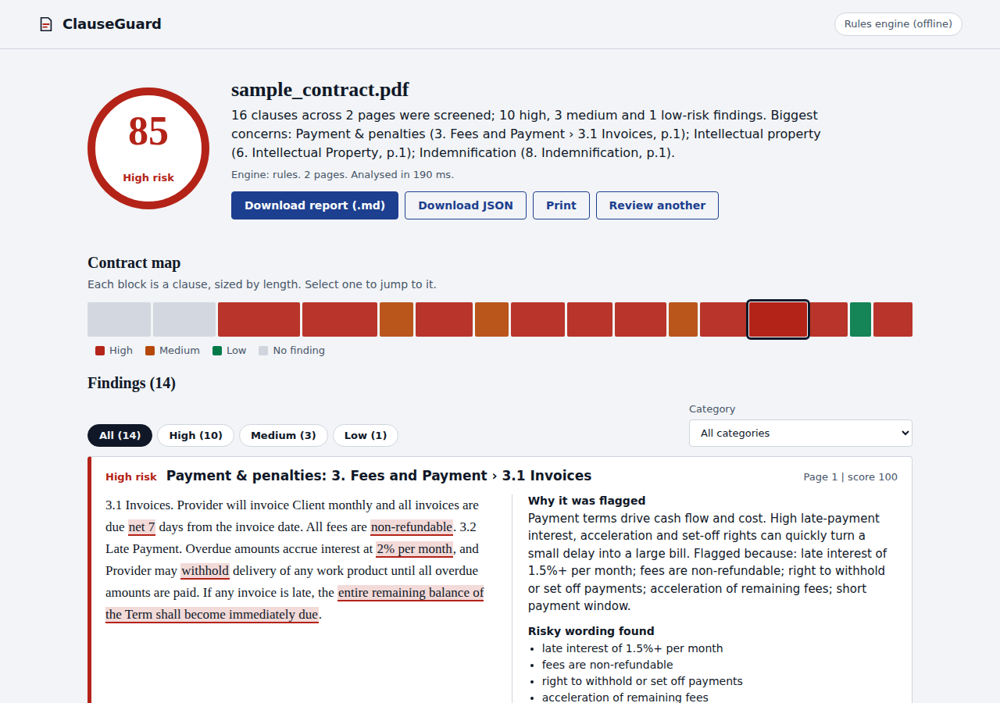
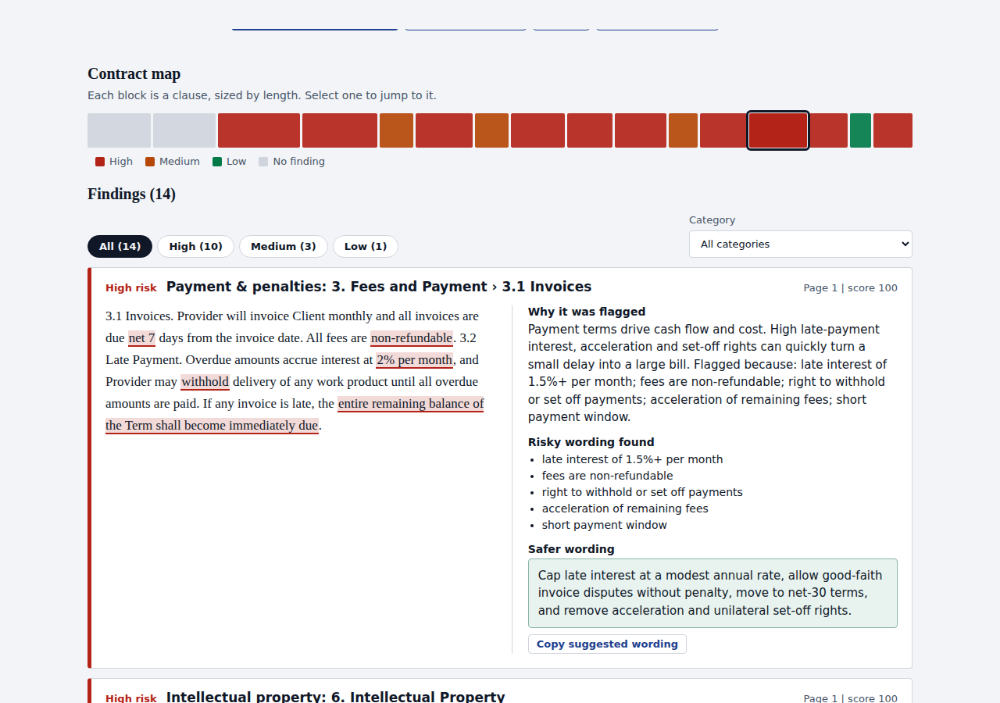
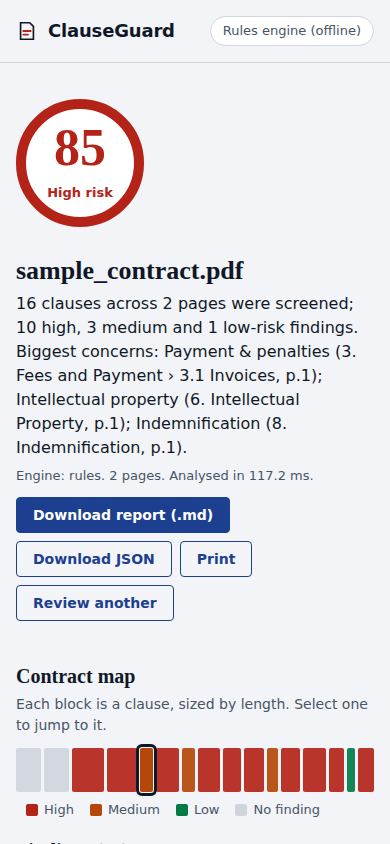

# ClauseGuard: contract risk review

Upload a contract PDF and get a clause-by-clause risk review in seconds: a 0-100 risk score, the exact words that triggered every flag, missing protections, and safer replacement wording. A deterministic rules engine produces the score; Gemini optionally adds tailored explanations and a second opinion.



## Why it exists

LLM-only contract reviewers are hard to trust: they can't show their work, they vary between runs, and they can be steered by text hidden inside the document. ClauseGuard splits the job:

| Layer | Responsibility | Properties |
|---|---|---|
| **Rules engine** | Classifies clauses, scores 0-100, highlights trigger phrases | Deterministic, offline, free, fully explainable |
| **Gemini (optional)** | Plain-English explanation, tailored redline, second-opinion risk | Schema-constrained, validated, never overrides the score |

If Gemini is unavailable (no key, quota, outage, malformed output) the review still completes with rule-based results.

## Features

- **Clause segmentation** from numbered headings (`4.`, `4.2`, `ARTICLE V`) with page numbers; paragraph fallback for unnumbered text
- **12 risk categories**: indemnification, limitation of liability, non-compete, auto-renewal, termination, IP assignment, confidentiality, payment and penalties, unilateral changes, disputes and governing law, warranty disclaimers, exclusivity and minimums
- **Explainable scoring**: each flag and each mitigating phrase adds or removes points you can see
- **Missing-protection detection**: no liability cap, no termination right, no governing law, no confidentiality
- **Prompt-injection detection**: flags text in the contract that is addressed to an AI reviewer
- **Contract map** UI: every clause is a block coloured by risk; click to jump
- **Exports**: Markdown report, JSON, print
- **Privacy**: uploads exist only in a temporary directory for the length of the request, then are deleted

| Contract map and filters | Mobile |
|---|---|
|  |  |

## Quick start

```bash
git clone https://github.com/arya251223/clauseguard
./run.sh                      # creates a venv, installs, serves http://127.0.0.1:8000
```

Or manually:

```bash
python3 -m venv .venv && . .venv/bin/activate
pip install -r requirements.txt
python -m app.server
```

Open http://127.0.0.1:8000 and click **Review the sample contract**.

### Docker

```bash
docker build -t clauseguard .
docker run -p 8000:8000 -e GEMINI_API_KEY=your_key clauseguard
```

### Enable Gemini enrichment (optional)

```bash
export GEMINI_API_KEY=your_key
export GEMINI_MODEL=gemini-3.5-flash     # change if Google retires the model
python scripts/check_gemini.py           # 10-second end-to-end check against the real API
```

## API

| Method | Path | Description |
|---|---|---|
| `POST` | `/api/audit` | Multipart upload: `file` (PDF), optional `engine` = `auto` \| `rules` \| `gemini` |
| `GET` | `/api/sample?engine=rules` | Audit the bundled risky sample contract |
| `GET` | `/api/audits/<id>` | Fetch a stored report (JSON) |
| `GET` | `/api/audits/<id>/report.md` | Download the Markdown report |
| `GET` | `/api/health` | Status, PDF backend, whether Gemini is configured |

```bash
curl -F "file=@samples/sample_contract.pdf" -F engine=rules http://127.0.0.1:8000/api/audit
```

Errors are JSON `{"error": "..."}` with: `400` bad request or engine, `413` too large, `415` not a PDF, `422` unreadable, scanned or too many pages.

## Configuration

| Variable | Default | Meaning |
|---|---|---|
| `GEMINI_API_KEY` | unset | Enables Gemini enrichment |
| `GEMINI_MODEL` | `gemini-2.5-flash` | Model name |
| `CG_MAX_UPLOAD_MB` | `10` | Upload size limit |
| `CG_MAX_PAGES` | `80` | Page limit |
| `CG_RESULTS_DIR` | `storage/results` | Where report JSON is stored |
| `HOST`, `PORT` | `127.0.0.1`, `8000` | Dev server bind |

## Architecture

```
PDF upload ─► validate (ext, %PDF magic, size) ─► temp file (deleted after request)
   │
   ▼
parser.py   PyMuPDF (or pdfplumber) ─► pages ─► clause segmentation (headings, pages)
   │
   ▼
rules.py    topic regex ─► red flags (+points, highlighted) ─► mitigators (-points) ─► score band
   │        + prompt-injection check + document-level gap check
   ▼
llm.py      (optional) MEDIUM/HIGH findings, batched ─► Gemini REST, JSON schema ─► validate ─► merge
   │        failure at any step ─► keep rule results
   ▼
auditor.py  aggregate: overall score, counts, contract map, summary ─► JSON report
   │
   ▼
server.py   Flask API + static UI   ─►   report.py  Markdown export
```

Scoring: a clause starts at 20 points when its topic matches; each red flag adds its weight, each mitigator subtracts; bands are HIGH ≥ 60, MEDIUM ≥ 35, else LOW. The overall score is `0.5 × worst + 0.35 × mean(top 5) + gap penalty`, capped at 100.

## Tests and evaluation

```bash
python -m unittest discover -s tests -t . -v     # 59 tests, ~2 s, no network needed
python eval/run_eval.py                          # labelled-clause evaluation
python eval/benchmark.py                         # latency by document size
```

Tests cover the parser, every rule (positive, negative and mitigated cases), a golden-file regression on the sample contract, the Gemini client with an injected fake transport (retry on 429, malformed JSON, invalid items dropped, fallback), and the HTTP layer (validation, limits, traversal, headers).

Evaluation on a 36-clause labelled set: **92% exact four-class accuracy; 100% recall and precision on clauses needing attention (MEDIUM or HIGH)**. The labels were written by the author and the rules were tuned on the first run's misses, so treat this as a sanity check rather than an independent benchmark.

Latency (rules engine, pdfplumber backend): 2 pages 0.09 s, 13 pages 0.7 s, 33 pages 1.9 s, 65 pages 4.0 s. Extraction dominates; rule analysis is about 1.4 ms per clause. PyMuPDF is selected automatically when installed.

## Security notes

- Contract text is untrusted: it is rendered with `textContent` only, sent to Gemini as quoted data under a system instruction that forbids following embedded instructions, and the response is schema-constrained and validated
- Uploads: extension and `%PDF-` magic check, size and page limits, random report IDs validated against a strict pattern, no user-controlled paths
- Headers: CSP (`default-src 'self'`), `nosniff`, no-referrer, frame blocking
- The API key is sent in a header, never in the URL

## Limitations

- English-language contracts only; scanned PDFs need OCR first (they are rejected with a clear message)
- Rules are heuristics over phrasing, so unusual wording can be missed and some one-flag clauses land in MEDIUM when a lawyer would say HIGH
- Whether a clause is risky depends on which side you are on; the rules assume you are the party bearing the obligation
- **This is screening support, not legal advice**

## Project structure

```
app/        config, models, parser, rules, llm, auditor, report, server
static/     index.html, style.css, app.js   (no build step, no dependencies)
samples/    sample_contract.pdf (risky), safe_contract.pdf (balanced), generator script
tests/      58 unit and integration tests
eval/       labelled clauses, evaluation and benchmark scripts
scripts/    check_gemini.py
docs/       screenshots and example outputs (Markdown and JSON)
```

## Roadmap

OCR for scans, side selection (client or vendor), DOCX input, custom rule packs per jurisdiction, reviewer comments and export to DOCX redlines.

## License

MIT
